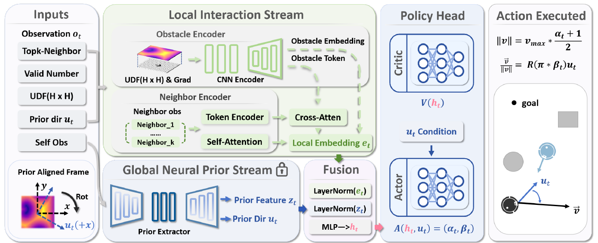

<div align="center">

<h1>PGRL-Nav: Prior-Guided Residual Reinforcement Learning for Decentralized Multi-Robot Navigation</h1>

<p>
  Boyang Zhou &nbsp;&middot;&nbsp; Ziyang Zhang &nbsp;&middot;&nbsp; Haocheng Peng &nbsp;&middot;&nbsp;
  Yujun Shen &nbsp;&middot;&nbsp; Hujun Bao &nbsp;&middot;&nbsp; Zhaopeng Cui
</p>

<p><strong>IROS 2026</strong></p>

<p>
  <a href="#installation">Installation</a> &nbsp;|&nbsp;
  <a href="#training">Training</a> &nbsp;|&nbsp;
  <a href="#evaluation">Evaluation</a> &nbsp;|&nbsp;
  <a href="#citation">Citation</a>
</p>

</div>

PGRL-Nav separates geometry-aware global guidance from interaction-aware local control. A frozen neural time-to-arrival field supplies obstacle-aware guidance and global features. A shared PPO actor-critic combines this prior with local LiDAR geometry and neighbor observations, then predicts residual controls that adjust speed and heading relative to the guidance direction.



*Overview of PGRL-Nav (Figure 2 in the paper).*

This repository provides the navigation model, multi-robot simulation environment, training and evaluation scripts, and three maps with pretrained global-planner weights.

## Installation

The dependency configuration uses Python 3.10, PyTorch 2.5.1 with CUDA 11.8, Ray/RLlib 2.51.1, and IR-SIM 2.12.1.

```bash
git clone https://github.com/AugetyVolta/PGRL-Nav.git
cd PGRL-Nav

conda create -n pgrl python=3.10 -y
conda activate pgrl
python -m pip install torch==2.5.1 torchvision==0.20.1 torchaudio==2.5.1 --index-url https://download.pytorch.org/whl/cu118
python -m pip install -r requirements.txt
```

Training uses CUDA. Evaluation also supports CPU execution. RLlib uses the Policy/ModelV2 API stack. The `ir-sim[fast]` dependency enables the compiled LiDAR backend; its first invocation may take longer while the kernel is compiled.

Run the following commands from the repository root.

## Environments and pretrained priors

The supplied environments are `random_env`, `random_env_1`, and `random_env_2`. Each directory contains a map and its corresponding pretrained planner:

```text
config/
├── random_env/
│   ├── random_env.yaml    # Simulation scene
│   ├── random_env.obj     # Map geometry
│   └── random_env.pt      # Global-planner weights
├── random_env_1/
└── random_env_2/
```

`--env` selects a **directory under `config/`**, such as `--env random_env_1`. Each environment directory must contain one scene YAML with `world` and `robot` sections and one matching planner checkpoint (`.pt`, `.pth`, or `.ckpt`). Filenames may differ from the directory name. Additional maps can use the same directory structure.

The supplied planner weights are used to construct navigation priors. Trained navigation-policy checkpoints are produced separately by `train.py`.

## Training

Train a policy on a supplied map:

```bash
python train.py --env random_env --output-dir logs/pgrl_random_env
```

Replace `random_env` with another environment directory to select a different map and planner. If `--output-dir` is omitted, the experiment is named automatically using the environment name and timestamp. A new output directory must be empty or absent.

### Default configuration

| Setting | Default |
| --- | --- |
| Training robots | 10 |
| Training iterations | 200 |
| Learner GPUs | 1 (configurable with `--num-gpus`) |
| Robot model | Omnidirectional, circular |
| Robot radius | 0.1 m |
| Goal threshold | 0.3 m |
| Maximum speed | 1.5 m/s |
| Simulation timestep | 0.1 s |
| LiDAR | 200 beams, 6 m range, 6.28 rad field of view |
| Per-robot task timeout | 500 steps |

Configuration groups are defined in [`env/params.py`](env/params.py). Robot and simulation-time settings are applied when constructing the environment; map dimensions and obstacle geometry come from the selected scene. Training runs headless by default.

For an experiment-specific configuration, create an override file containing only the fields to change. For example, `train_config.yaml`:

```yaml
experiment_params:
  num_gpus: 2
  num_env_runners: 2
  num_envs_per_env_runner: 4
algorithm_params:
  lr: 0.00002
```

```bash
python train.py --env random_env --output-dir logs/pgrl_custom --override-config train_config.yaml
```

Use `--num-gpus` to select the learner GPU count, independently of `num_gpus_per_env_runner`:

```bash
CUDA_VISIBLE_DEVICES=0,1 python train.py --env random_env --num-gpus 2
```

The default remains one learner GPU. `experiment_params.num_gpus` can also be set in `env/params.py` or an override YAML; the command-line value takes precedence, including when resuming. Saved checkpoints retain the effective setting. Increasing the GPU count does not change the configured PPO minibatch size or number of epochs.

With multiple learner GPUs, minibatch updates synchronize trainable parameters and buffers while reusing the frozen planner weights on each GPU. A full synchronization runs on the first update and after restoring weights. Single-GPU training uses RLlib's native update; the PPO loss and model architecture are unchanged.

Set sampling-worker CPU/GPU allocations in `experiment_params` to fit the machine. Multiple environments within a worker are stepped sequentially, with policy inference batched across agents.

### Resume training

Continue from iteration 200 to a total of 300 iterations:

```bash
python train.py --resume logs/pgrl_random_env --iter 200 --max-iters 300
```

To branch from an earlier checkpoint into a new experiment:

```bash
python train.py --resume logs/pgrl_random_env --iter 100 --max-iters 200 --output-dir logs/pgrl_branch
```

Resuming restores the model, optimizer, iteration counter, and saved experiment configuration. `--iter N` loads `ckpts/iter_XXXXXX` and continues from iteration N+1. `--max-iters` specifies the total target iteration count. Use `--override-config` to change selected saved settings; an explicit `--max-iters` takes precedence.

By default, resumed training appends to the original experiment. Use a new `--output-dir` when branching from an earlier checkpoint whose later iterations already exist. For an older experiment saved with plotting enabled, set `experiment_params.disable_plotting: true` in the override file to resume headlessly.

## Evaluation

Evaluate a trained policy with 20 robots and save the metrics:

```bash
python evaluate_metrics.py --log-dir logs/pgrl_random_env --iter 200 \
  --num-robots 20 --episodes 100 --max-steps 5000 --out-json results.json
```

Visualize navigation:

```bash
python evaluate.py --log-dir logs/pgrl_random_env --iter 200 \
  --num-robots 20 --episodes 2 --max-steps 5000 --render
```

Both scripts restore the map, planner, and model configuration from the experiment directory. Omit `--num-robots` to use the training team size. Omit `--render` for headless evaluation, or add `--device cpu` for CPU execution.

| Argument | Description |
| --- | --- |
| `--log-dir` | Training experiment directory; required |
| `--iter` | Saved training iteration; required |
| `--num-robots` | Evaluation team size; defaults to the saved training value |
| `--episodes` | Evaluation episodes; defaults to 20 for metrics and 2 for visualization |
| `--max-steps` | Per-episode step limit; defaults to 5000 |
| `--device` | `cuda` or `cpu`; defaults to CUDA when available |
| `--cpus` | Ray CPU allocation; defaults to 8 |
| `--render` | Enable visualization |
| `--out-json` | Output file for `evaluate_metrics.py` |

The metrics output contains per-episode results, aggregate statistics, and the evaluation configuration. Reported statistics include team and agent success rates, path length, return, speed, and episode length. The per-robot task timeout from the saved configuration remains active alongside `--max-steps`.

## Experiment outputs

```text
logs/pgrl_random_env/
├── scene_config.yaml          # Saved experiment configuration
├── env.yaml                   # Effective simulation scene
├── ntfields.pt                # Archived global planner
├── ckpts/
│   ├── iter_000001/
│   ├── ...
│   ├── iter_000200/
│   └── final/
└── tensorboard/               # TensorBoard events and training logs
```

A checkpoint is saved after each iteration and at the end of training. In-place resuming writes its configuration to `scene_config_resume.yaml` and retains the original configuration snapshot.

```bash
tensorboard --logdir logs
```

## Additional tools

<details>
<summary>Generate a random map</summary>

Map-generation parameters are defined in `MapGenerationParameters` in [`env/params.py`](env/params.py).

```bash
python -m utils.gen_env
```

The example writes `config/random_env.yaml` and `config/random_env.obj`. Place a generated map in a new environment directory and add its corresponding trained planner checkpoint before using it with `--env`.

</details>

<details>
<summary>Convert a checkpoint from an older code version</summary>

```bash
python tools/migrate_checkpoint.py --checkpoint /path/to/checkpoint --output-dir logs/converted_experiment
```

The converter creates a copy with the current module and configuration names, preserving weights, optimizer state, and iteration counters. Use `--rename-key OLD=NEW` if it reports a renamed configuration field. Conversion requires a compatible model architecture.

</details>

## Citation

If you use PGRL-Nav in your research, please cite:

```bibtex
@inproceedings{zhou2026pgrlnav,
  title     = {{PGRL-Nav}: Prior-Guided Residual Reinforcement Learning for Decentralized Multi-Robot Navigation},
  author    = {Zhou, Boyang and Zhang, Ziyang and Peng, Haocheng and Shen, Yujun and Bao, Hujun and Cui, Zhaopeng},
  booktitle = {2026 IEEE/RSJ International Conference on Intelligent Robots and Systems (IROS)},
  year      = {2026},
  pages     = {15176--15183}
}
```
